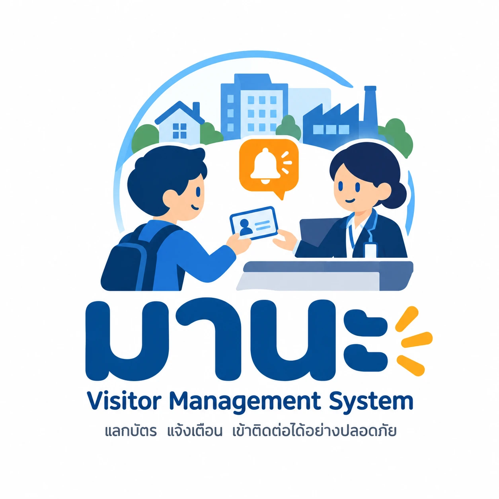

# มานะ — Visitor Management System (หมู่บ้าน · สำนักงาน · โรงงาน)



ชื่อและโลโก้ที่ผู้ใช้เห็นอยู่ที่ `src/lib/brand.ts` + `public/brand/` (ไอคอนเว็บ `src/app/icon.png`) · ไฟล์โลโก้สำหรับเอกสาร/LINE OA อยู่ที่ `docs/brand/`

Next.js 16 (App Router) · Tailwind v4 · shadcn/ui · Prisma 7 + PostgreSQL

## เริ่มต้นใช้งาน

```bash
cp .env.example .env          # แก้ secret ก่อนใช้งานจริง
npm install                   # postinstall จะรัน prisma generate
npm run db:up                 # PostgreSQL ผ่าน Docker
npx prisma migrate dev --name init
npm run db:seed
npm run dev                   # http://localhost:3000/check-in
```

- `/check-in` และ `/check-in?mode=factory` — ฟอร์มลงทะเบียน
- `/pass/:visitId?print=1` — สลิปบัตรผ่าน (สั่งพิมพ์อัตโนมัติ)

กล้องใช้ได้บน `localhost` หรือ HTTPS เท่านั้น ถ้าจะใช้แท็บเล็ตในวง LAN ให้รัน `next dev --experimental-https`

## โครงสร้าง (Clean Architecture)

```
src/
├─ domain/          กฎธุรกิจล้วน (mask เลขบัตร, เวลาที่อยู่ภายใน, overstay) — ไม่ขึ้นกับ framework
├─ application/     use case + ports (interfaces) + zod schema
├─ infrastructure/  adapter: Prisma, storage, crypto, notifier
├─ features/        UI + server actions แยกตามฟีเจอร์ (check-in, pass)
├─ components/ui/   shadcn/ui primitives
├─ app/             routes บาง ๆ ที่ประกอบ feature เข้าด้วยกัน
└─ container.ts     composition root (สลับ adapter ได้จากจุดเดียว)
```
Dependency rule: `app → features → application → domain` และ `infrastructure` implement ports ของ `application`

## พิมพ์ Thermal
ตั้งค่าเครื่องพิมพ์: Paper = 80mm (หรือ 58mm) × Receipt, Margins = None, ปิด Headers/Footers
สำหรับ kiosk ที่ไม่ต้องการ dialog: เปิด Chrome ด้วย `--kiosk-printing`

## สแกนบัตร / ป้ายทะเบียน (OCR ในเครื่อง)
- **ป้ายทะเบียน**: ถ่ายภาพป้ายในกรอบ → อ่านทะเบียน + จังหวัดให้อัตโนมัติ (Tesseract ในเบราว์เซอร์ อ่าน 3 ส่วน: หมวด/เลข/จังหวัด, เทียบชื่อ 77 จังหวัดแบบคลาดเคลื่อนได้) — เจ้าหน้าที่ตรวจทานก่อนบันทึก · ทดสอบ: `npm run test:plate`
- **เครื่องอ่านบัตรประชาชน (Smart Card)**: เสียบบัตร → กรอกชื่อ/เลขบัตร + รูปจากชิปให้อัตโนมัติ ผ่านโปรแกรมเชื่อม `npm run card-agent` (หรือ `เปิดเครื่องอ่านบัตร.command`) · ลองโดยไม่มีเครื่อง: `npm run card-agent -- --simulate` · ทดสอบ: `npm run test:cardreader` · รายละเอียด `docs/เครื่องอ่านบัตร.md`
- **ภาพป้ายทะเบียน**: เก็บที่ `storage/photos/plates` · ดูได้เฉพาะผู้ดูแลระบบ (ภาพย่อในหน้ารายงาน → คลิกเปิดภาพเต็ม) · ลบอัตโนมัติตามระยะเวลาเก็บรูปถ่ายที่ตั้งค่า → PDPA
ปุ่ม "สแกนบัตร (กรอกอัตโนมัติ)" ในหน้า Check-in — อ่านบัตรประชาชน / ใบขับขี่ / พาสปอร์ต (MRZ) ด้วย Tesseract.js ในเบราว์เซอร์
- ไฟล์โมเดลถูกคัดลอกไว้ที่ `public/ocr` ตอน `npm install` (scripts/copy-ocr-assets.mjs) — ไม่โหลดจาก CDN
- ภาพบัตรไม่ถูกบันทึก/ส่งออก ดึงเฉพาะชื่อ + เลขเอกสาร (ไม่เก็บศาสนา/ที่อยู่/วันเกิด)
- ตัวแยกข้อมูล: `src/domain/visit/id-card-parser.ts`

## Check-out (`/check-out`)
- สแกน QR บนสลิป (กล้อง / เครื่องสแกน USB) หรือพิมพ์รหัสบัตร — QR ถูกตรวจลายเซ็น HMAC ก่อนเสมอ
- คำนวณเวลาที่อยู่ภายใน และแจ้งเตือน Overstay (ระบบไม่คำนวณค่าจอดรถ)
- E-Stamp: กรอก OTP จาก Host (ผิดได้ 5 ครั้งแล้วล็อก) หรือประทับแทนพร้อมเหตุผล
- โรงงาน: กรอกน้ำหนักชั่งออก → น้ำหนักสุทธิ, เตือนปิด Work Permit / คืน PPE
- รายชื่อผู้ที่ยังอยู่ในพื้นที่ (คนที่เกินเวลาขึ้นก่อน) รีเฟรชทุก 1 นาที
- Use case: `src/application/check-out/` · ทุกเหตุการณ์บันทึกใน `VisitEvent`

> หลังแก้ `schema.prisma` ต้องรีสตาร์ท `npm run dev` เพื่อให้ Prisma Client ใหม่มีผล

## E-Stamp สำหรับ Host (`/stamp/:token`)
- ลิงก์ถูกสร้างตอน Check-in (เมื่อเลือก Host + เปิด E-Stamp) และส่งให้ Host ผ่าน `Notifier` (ตอนนี้แสดงใน console)
- Host กด "อนุมัติ" หรือ "ไม่อนุมัติ" (ใส่เหตุผลได้) — ตัดสินได้ครั้งเดียว, หมดอายุพร้อม OTP (12 ชม.), ใช้ไม่ได้หลังผู้ติดต่อออกแล้ว
- token สุ่ม 192 bit, หน้าเพจตั้ง `noindex` และ `no-referrer`
- ถ้าให้ Host เปิดจากมือถือ ต้องตั้ง `NEXT_PUBLIC_APP_URL` เป็นที่อยู่ที่มือถือเข้าถึงได้ (IP ในวง LAN หรือโดเมนจริง)

## ระบบ Login เจ้าหน้าที่
- ทุกหน้า (ยกเว้น `/login`, `/stamp/*`) ต้อง login — `src/proxy.ts` ตรวจเบื้องต้น, `requireStaff()` ตรวจจริงในทุกหน้าและทุก server action
- บทบาท: `ADMIN` (จัดการเจ้าหน้าที่ที่ `/admin/users`) และ `STAFF`
- รหัสผ่าน: scrypt · ผิด 5 ครั้งล็อก 15 นาที · session 12 ชม. (cookie httpOnly) · บังคับเปลี่ยนรหัสเมื่อ login ครั้งแรก/หลังรีเซ็ต
- บันทึกชื่อผู้ใช้เจ้าหน้าที่ใน `checkedInBy`, `checkedOutBy`, `stampedBy` และ `VisitEvent.actor`
- บัญชีแอดมินคนแรก: ตั้ง `INITIAL_ADMIN_PASSWORD` ใน `.env` แล้วรัน `npm run user:admin`

> ⚠️ อย่าเก็บโปรเจกต์ไว้ในโฟลเดอร์ที่ซิงก์กับ iCloud (Desktop/Documents) — ไฟล์ฐานข้อมูลและ node_modules จะถูกย้ายขึ้นคลาวด์ ทำให้ระบบค้างหรือข้อมูลเสียหาย

## รูปถ่าย (PDPA)
- รูปใบหน้า/ป้ายทะเบียนเก็บที่ `storage/photos/` (นอก `public/`) — เปิดได้ผ่าน `/photos/...` เท่านั้น
- สิทธิ์: เจ้าหน้าที่ที่ login แล้ว หรือ Host ที่ถือลิงก์ E-Stamp ที่ยังไม่หมดอายุ (`?st=`) เฉพาะรูปใบหน้าของรายการนั้น
- ไม่มีสิทธิ์ → ตอบ 404 · `Cache-Control: private, no-store` · กัน path traversal ด้วย regex เข้มงวด
- สำรองข้อมูล: ต้อง backup ทั้งฐานข้อมูลและโฟลเดอร์ `storage/`

## ระยะเวลาเก็บข้อมูล (PDPA)
- ตั้งค่าที่ `/admin/data-retention` (เฉพาะ ADMIN) — ค่าเริ่มต้น: รูปถ่าย 90 วัน, ข้อมูลส่วนบุคคล 365 วัน
- รูปถ่าย: ลบไฟล์ + ล้างการอ้างอิง เมื่อการเข้าพื้นที่สิ้นสุดเกินกำหนด
- ข้อมูลส่วนบุคคล: ทำให้ไม่ระบุตัวตน (ชื่อ, เบอร์, อีเมล, เลขบัตร/hash, ทะเบียนรถ, คนขับ, หมายเหตุ) เมื่อการมาครั้งล่าสุดเกินกำหนด — สถิติการเข้า-ออกยังเก็บไว้
- ไม่แตะ: ผู้ที่ยังอยู่ในพื้นที่ และผู้ที่อยู่ใน blacklist
- รันอัตโนมัติทุก 6 ชม. (`src/instrumentation.ts`, ปิดได้ด้วย `RETENTION_SCHEDULER=off`) หรือ `npm run retention:run [-- --dry]`
- ทุกครั้งที่รันบันทึกใน `DataPurgeLog`
- ตัวตั้งเวลาออกแบบสำหรับเซิร์ฟเวอร์ตัวเดียว — ถ้ารันหลาย instance ให้ปิด scheduler แล้วใช้ cron เรียก `npm run retention:run` แทน

## แจ้งเตือน Host ทาง LINE
ใช้ **LINE Messaging API** (LINE Notify ปิดบริการแล้วตั้งแต่ 31 มี.ค. 2025)

### ตั้งค่าครั้งแรก
1. สร้าง LINE Official Account ที่ https://manager.line.biz และเปิดใช้ Messaging API (Settings → Messaging API)
2. ใน https://developers.line.biz/console → channel ของ OA:
   - **Basic settings** → คัดลอก *Channel secret* → `LINE_CHANNEL_SECRET`
   - **Messaging API** → ออก *Channel access token (long-lived)* → `LINE_CHANNEL_ACCESS_TOKEN`
   - **Messaging API** → *Bot basic ID* (เช่น `@123abcde`) → `LINE_OA_BASIC_ID`
   - **Webhook URL** → `{NEXT_PUBLIC_APP_URL}/api/line/webhook` แล้วเปิด *Use webhook* และกด *Verify*
3. ปิด *Auto-reply messages* และ *Greeting messages* ใน LINE OA Manager (ให้ระบบตอบเอง)
4. ตั้ง `NEXT_PUBLIC_APP_URL` เป็นที่อยู่ HTTPS ที่มือถือของ Host เปิดได้ แล้วรีสตาร์ทโปรแกรม
5. ไปที่เมนู **LINE** (แอดมิน) → สร้างรหัสเชื่อมต่อให้ Host → Host เพิ่มเพื่อน OA แล้วพิมพ์รหัส

### หมายเหตุ
- Webhook ต้องเป็น HTTPS ที่อินเทอร์เน็ตเข้าถึงได้ — ถ้ารันบนเครื่องในออฟฟิศ ใช้ Cloudflare Tunnel / ngrok
- ข้อความแจ้งเตือนไม่แนบรูปใบหน้า (ไม่ส่งข้อมูลชีวภาพให้บุคคลที่สาม) — ส่งเฉพาะชื่อ บริษัท วัตถุประสงค์ เวลา ทะเบียนรถ
- ถ้า LINE ส่งไม่สำเร็จหรือ Host ยังไม่เชื่อมต่อ → ลิงก์อนุมัติ/OTP จะอยู่ใน log ของเซิร์ฟเวอร์ และบันทึก `HOST_NOTIFIED` (ok/error) ในประวัติของ Visit
- Push message นับโควตาของแพ็กเกจ LINE OA (แพ็กเกจฟรีมีจำนวนข้อความต่อเดือนจำกัด)
- Host บล็อก OA → ระบบยกเลิกการเชื่อมต่ออัตโนมัติ

## เปิดระบบออนไลน์ (Cloudflare Tunnel)
ดับเบิลคลิก **`เปิดระบบออนไลน์.command`** (หรือ `npm run online`) — ทำให้ครบ: ฐานข้อมูล → build (เมื่อโค้ดเปลี่ยน) → tunnel → `next start` (production) แล้วแสดง URL HTTPS
- ได้ HTTPS → แท็บเล็ต/มือถือใช้กล้องได้, Host เปิดลิงก์ E-Stamp จากมือถือได้, LINE webhook ใช้ได้
- URL ล่าสุดบันทึกที่ `storage/public-url.txt`

### Quick Tunnel (ค่าเริ่มต้น — ไม่ต้องมีบัญชี)
URL แบบ `https://xxxx.trycloudflare.com` **เปลี่ยนทุกครั้งที่เปิดใหม่** → เหมาะกับทดสอบ (ต้องอัปเดต Webhook URL ใน LINE ทุกครั้ง)

### Named Tunnel (ใช้งานจริง — URL ถาวร)
1. มีโดเมนที่ใช้ DNS ของ Cloudflare (เช่น `example.com`)
2. https://one.dash.cloudflare.com → Networks → Tunnels → **Create a tunnel** → Cloudflared → ตั้งชื่อ → คัดลอก **token** (ข้ามขั้นตอนติดตั้งในหน้าเว็บได้)
3. แท็บ **Public Hostname**: `vms.example.com` → Service `HTTP` → `localhost:3000`
4. ใส่ใน `.env`:
   ```
   CLOUDFLARE_TUNNEL_TOKEN="<token>"
   APP_URL="https://vms.example.com"
   ```
5. ดับเบิลคลิก `เปิดระบบออนไลน์.command` → ตั้ง LINE Webhook เป็น `https://vms.example.com/api/line/webhook` ครั้งเดียวจบ

### ความปลอดภัยเมื่อเปิดออนไลน์
- โหมด production เท่านั้น (ไม่ใช้ `next dev` กับอินเทอร์เน็ต)
- Cookie `Secure` อัตโนมัติเมื่อเข้าผ่าน HTTPS · Server Actions รับเฉพาะ origin ของ `APP_URL`
- Header: `X-Frame-Options: DENY`, `nosniff`, `Referrer-Policy`, `Permissions-Policy` (กล้องเฉพาะเว็บนี้)
- ควรเปลี่ยนรหัส admin ก่อนเปิดออนไลน์ และพิจารณาเปิด Cloudflare Access (Zero Trust) จำกัดหน้า `/admin` ให้เฉพาะอีเมลบริษัท

## Multi-tenant (หลายองค์กร)
ทุกข้อมูลผูกกับ `Organization` (ลูกค้าของแพลตฟอร์ม) — ข้อมูลเดิมย้ายเข้าองค์กร `main`

- **Login**: รหัสองค์กร + ชื่อผู้ใช้ + รหัสผ่าน (ลิงก์ `/login?org=<slug>` เติมรหัสองค์กรให้, เครื่องจำค่าล่าสุด)
- **แยกข้อมูล**: `src/infrastructure/db/tenant.ts` — `db(orgId)` คืน Prisma client ที่บังคับ `organizationId` ในทุก query ระดับบนสุด (ทับค่าที่ส่งมาเสมอ); nested create ต้องใส่ `organizationId` เอง (TypeScript บังคับ)
- `container.ts`: dependency ที่แตะข้อมูลลูกค้าเป็นฟังก์ชันของ `orgId` — **orgId ต้องมาจาก session (`requireStaff()`) เท่านั้น**
- ข้อยกเว้นที่ไม่ผูกองค์กรล่วงหน้า (สิทธิ์มาจาก token ที่สุ่ม): หน้า E-Stamp ของ Host, LINE webhook (รหัสเชื่อมต่อ), รูปผ่าน `?st=`
- ผู้ติดต่อ/รหัสบัตร/ชื่อผู้ใช้ ไม่ซ้ำ *ภายในองค์กร* — คนเดียวกันไปหลายองค์กรจะไม่ถูกเชื่อมข้อมูลกัน
- องค์กรสถานะ `SUSPENDED` → login ไม่ได้ และ session เดิมใช้ไม่ได้ทันที

### คำสั่งสำหรับผู้ให้บริการ
```bash
npm run org:create -- --slug acme --name "บจก. แอคมี"      # สร้างองค์กร + ผู้ดูแลคนแรก (แสดงรหัสชั่วคราวครั้งเดียว)
npm run test:isolation -- --http                          # ทดสอบการแยกข้อมูล 33 ข้อ (ควรรันก่อน deploy ทุกครั้ง)
SEED_ORG=acme npm run db:seed                             # ใส่ข้อมูลตัวอย่างให้องค์กร
```

### ยังไม่ได้ทำ (ขั้นถัดไปของ SaaS)
- PostgreSQL Row-Level Security เป็นชั้นป้องกันที่ 2
- หน้าสมัครใช้งานเอง + ยืนยันอีเมล + onboarding
- หน้าแก้ชื่อองค์กร / Super Admin ของผู้ให้บริการ
- LINE OA แยกต่อองค์กร (ตอนนี้ใช้ OA กลางของแพลตฟอร์ม)

## เพิ่มลูกค้า (ติดตั้งที่หน้างาน — ไม่มีการสมัครใช้งานเอง)
ผู้ให้บริการสร้างองค์กรให้ลูกค้าที่เมนู **ลูกค้า** (`/platform/customers`, ผู้ดูแลขององค์กร `PLATFORM_ORG_SLUG`) หรือคำสั่ง
`npm run org:create -- --slug suansuay --name "หมู่บ้านสวนสวย" --mode VILLAGE [--status TRIAL|ACTIVE] [--days 30] [--email ...]`
- กำหนด: ชื่อ, รหัสองค์กร (ใช้ login), **ประเภทธุรกิจ (เปลี่ยนภายหลังไม่ได้)**, อีเมลติดต่อ, ชื่อผู้ใช้ผู้ดูแล, สถานะเริ่มต้น (ทดลองใช้ N วัน / ใช้งานจริงไม่มีวันหมดอายุ)
- ได้รหัสชั่วคราว (แสดงครั้งเดียว) → ผู้ดูแลของลูกค้า login → บังคับตั้งรหัสใหม่ → ตั้งค่าเริ่มต้น (สถานที่ + วางรายชื่อจาก Excel) → ใช้งาน
- หน้า “ลูกค้า”: ดูสถานะ/การติดตั้ง/ใช้งานล่าสุด, รีเซ็ตรหัสผู้ดูแลของลูกค้า (ออกจากระบบทุกเครื่อง), ระงับ/ยกเลิกการระงับ (ระงับองค์กรผู้ให้บริการไม่ได้)
- **ข้อมูลตามสัญญา** (กรอกตอนสร้าง แก้ได้ที่ปุ่ม "สัญญา"): จำนวนจุดลงทะเบียน (1–999) + **จำนวนบ้าน (เฉพาะหมู่บ้าน, บังคับ)** — ลูกค้าเพิ่ม/นำเข้า/เปิดใช้งานบ้านเกินจำนวนไม่ได้ (นับเฉพาะบ้านที่เปิดใช้งาน; ลูกค้าเดิมที่ยังไม่กำหนด = ไม่จำกัด) + ข้อมูลใบกำกับภาษี (ชื่อผู้ซื้อ, เลขผู้เสียภาษี 13 หลัก ตรวจ checksum, สำนักงานใหญ่/สาขาที่ 5 หลัก, ที่อยู่, อีเมลรับเอกสาร) — ลดจุดต่ำกว่าที่ใช้อยู่ได้ จุดที่ลงทะเบียนทีหลังสุดจะหยุด Check-in
- **วันสิ้นสุดสัญญา**: แจ้งเตือนล่วงหน้า 60 วัน (`CONTRACT_NOTICE_DAYS` ใน `src/domain/org/contract.ts`) — แถบเตือนบนหน้า "ลูกค้า" + ตัวเลขบนเมนู · ไม่หยุดการใช้งานอัตโนมัติ
- **ค้นหา/กรอง** (ชื่อ รหัส อีเมล ชื่อผู้ซื้อ เลขผู้เสียภาษี · ประเภท · สถานะ · สัญญา) ตัวกรองอยู่ใน URL · **ส่งออก Excel** (`/platform/customers/export`, CSV + BOM) ตามตัวกรองที่เลือก
- ทดสอบ: `npm run test:customers` (52 ข้อ)
- หน้า `/terms`, `/privacy` เป็นร่างโครง — ต้องให้ฝ่ายกฎหมายเขียนเนื้อหาจริงก่อนใช้งานจริง

## โหมดหมู่บ้าน / คอนโด (VILLAGE)
- **1 องค์กร = 1 โหมด**: อาคารสำนักงาน · โรงงาน · หมู่บ้าน/คอนโด — เลือกครั้งเดียวตอนตั้งค่าเริ่มต้น (`Organization.siteMode`) เปลี่ยนภายหลังไม่ได้
  - สถานที่ใหม่ใช้โหมดขององค์กรเสมอ · หน้า Check-in/รายชื่อ แสดงเฉพาะสถานที่ตามโหมด · Check-in ที่สถานที่ต่างโหมดถูกปฏิเสธ (ประวัติเดิมยังอยู่ในรายงาน)
  - องค์กรเก่าที่ยังไม่มีค่า → ใช้โหมดของสถานที่แรก (`src/infrastructure/repositories/org-mode.ts`)
- ใช้ตาราง Tenant/Host เดิม: **บ้าน** = Tenant (`name` = บ้านเลขที่, `floor` = ซอย/โซน), **ลูกบ้าน** = Host — ลูกบ้านเชื่อม LINE และยืนยันผู้มาหา (E-Stamp) ได้เหมือน Host
- วัตถุประสงค์ของหมู่บ้าน: เยี่ยมญาติ/เพื่อน, ส่งพัสดุ, ส่งอาหาร, ช่างซ่อม, ผู้รับเหมา, อื่น ๆ · ต้องเลือกบ้านหรือลูกบ้าน · ส่วนรถเปิดไว้ก่อน
- คำเรียก/การแสดงผลรวมไว้ที่ `src/domain/visit/labels.ts` (`DIRECTORY_TERMS`, `visitingText`, `stampStatusLabel`)

## แจ้งแขกล่วงหน้า + QR (หมู่บ้าน / ออฟฟิศ)

1. ลูกบ้าน/Host ที่เชื่อม LINE แล้ว พิมพ์ **“แจ้งแขก”** ในแชต LINE OA → ได้ปุ่มเปิดหน้า `/r/:ลิงก์ส่วนตัว` (ใช้ได้ 24 ชม. ผูกกับบัญชี LINE นั้น)
2. กรอกช่วงเวลา (ไม่เกิน 7 วัน ล่วงหน้าไม่เกิน 60 วัน) ทะเบียนรถ ชื่อแขก (ไม่บังคับ) → ได้ QR
3. ส่งให้แขก: ปุ่ม “ส่งทาง LINE” (ลิงก์ `/g/:token`) หรือ “บันทึก/ส่งเป็นรูป” (รูป QR ใช้ได้แม้ URL ของระบบเปลี่ยน)
4. หน้า Check-in: “สแกน QR แขก” (กล้อง / เครื่องสแกน USB) หรือ “รายชื่อวันนี้” → กรอกบ้าน/ลูกบ้าน/ทะเบียนให้อัตโนมัติ · รปภ. ตรวจบัตร/ถ่ายรูปตามแบบฟอร์มเดิม
5. Check-in แล้ว: QR ใช้ซ้ำไม่ได้ · ส่ง LINE “มีคนมาหานะ — แขกมาถึงแล้ว” ให้ **สมาชิกทุกคนในบ้าน** ที่เชื่อม LINE (ผู้ที่ได้ข้อความ E-Stamp แล้วไม่ได้ซ้ำ)

เมนูด้านล่างแชต (Rich Menu): ปุ่ม “แจ้งแขก” / “วิธีใช้” — ตั้งด้วย `npm run line:richmenu` (ดูรูปก่อน: `-- --preview` · ลบ: `-- --remove`) รูปอยู่ที่ `docs/brand/มานะ-RichMenu.png`

เข้าได้ก่อนเวลาที่แจ้งไม่เกิน 60 นาที · หลังเวลาสิ้นสุดใช้ไม่ได้ · ลูกบ้านยกเลิกได้ · ลบอัตโนมัติตามระยะเก็บข้อมูลส่วนบุคคล (PDPA) · ทดสอบ: `npm run test:invite`

## ตั้งค่า (ผู้ดูแลระบบ) — เมนู “ตั้งค่า”
- **รายชื่อ** (`/admin/directory`): เพิ่ม/แก้/ปิดใช้งาน สถานที่ · บริษัทผู้เช่า/บ้าน · ผู้รับพบ/ลูกบ้าน · จุดขนถ่าย, นำเข้าจาก Excel (วางข้อความ — ข้ามชื่อซ้ำ) — ปิดใช้งานแทนการลบเพื่อให้ประวัติครบ, เปลี่ยนประเภทสถานที่ภายหลังไม่ได้
- **แบบฟอร์ม** (`/admin/form`): ช่องมาตรฐาน ซ่อน/ไม่บังคับ/บังคับกรอก (บริษัท, เบอร์โทร, ภาพถ่าย, เลขบัตรแลก, รายละเอียด, ผู้รับพบ, ข้อมูลรถ, ภาพป้ายทะเบียน; เลขบัตร = ไม่บังคับ/บังคับ), เปิด-ปิดวัตถุประสงค์, **ช่องที่เพิ่มเอง** (ข้อความ/ตัวเลข/ตัวเลือก/ติ๊ก, บังคับได้, เลือกโหมด, แสดงบนบัตร) — ค่าเก็บใน `Visit.customValues` พร้อมชื่อช่อง ณ วันที่บันทึก และถูกลบพร้อมข้อมูลส่วนบุคคลตามนโยบาย PDPA
- **เวลาอยู่ได้ / ไม่จำกัดเวลา**: ตั้งค่าสถานที่ “อยู่ได้สูงสุด (ชม.)” 0.5–168 ชม. หรือติ๊ก “ไม่จำกัดเวลา” · หน้า Check-in เลือกต่อรายได้ (ตามค่าตั้ง / 1 ชม.–3 วัน / ไม่จำกัดเวลา) — ไม่จำกัด = `expectedCheckOutAt` เป็น null, บัตรแสดง “ใช้ได้ถึง: ไม่จำกัดเวลา” และไม่นับว่าอยู่เกินเวลา
- **ชื่อ-นามสกุล** บังคับ/ไม่บังคับ (หมู่บ้าน: ค่าเริ่มต้น ชื่อและเบอร์โทร “ไม่บังคับ” — ไม่กรอกบันทึกเป็น “ไม่ระบุชื่อ” และไม่ลบชื่อเดิมของผู้ติดต่อที่เคยมา)
- **เก็บภาพบัตร**: ภาพจากการสแกนบัตร (ซ่อน = ไม่เก็บ / ไม่บังคับ = เก็บเมื่อสแกน / บังคับ = ต้องสแกน) → `storage/photos/idcards` เปิดได้เฉพาะเจ้าหน้าที่ขององค์กร (ไม่เปิดผ่านลิงก์ E-Stamp ของ Host) และลบตามระยะเวลาเก็บรูป (PDPA)
- **Safety & Work Permit (โรงงาน)**: PPE ทีละรายการ, Safety Induction, เลขที่ Work Permit (บังคับเมื่อมีงานเสี่ยง) = ซ่อน/ไม่บังคับ/บังคับ, ประเภทงานเสี่ยง = ซ่อน/แสดง — ค่าเริ่มต้น: หมวก รองเท้า เสื้อสะท้อนแสง และ Induction บังคับ
- การตรวจ: `src/application/check-in/form-rules.ts` (ฝั่ง server เสมอ — ช่องที่ซ่อนจะไม่ถูกบันทึกแม้ถูกส่งมา)
- ไม่กรอกเลขบัตร (เมื่อตั้งเป็นไม่บังคับ) → บันทึกเป็น “ไม่ได้ระบุ” และตรวจรายชื่อห้ามเข้าไม่ได้

## รายงาน (`/reports`)
- เจ้าหน้าที่ทุกคนดูได้: สรุป (จำนวนครั้ง, จำนวนคน, มากับรถ, เวลาเฉลี่ย, เกินเวลา, อยู่ในพื้นที่ตอนนี้), กราฟรายวัน/รายชั่วโมง (เวลาไทย), วัตถุประสงค์, บริษัท/บ้านที่มีผู้มามากสุด, ประวัติเข้า-ออก ค้นหาด้วย ชื่อ/บริษัท/ทะเบียน/รหัสบัตร/บ้านเลขที่/ผู้รับพบ/เบอร์โทร (≥4 หลัก)
- **ดาวน์โหลด Excel (CSV)** `/reports/export` — เฉพาะผู้ดูแลระบบ, UTF-8 BOM (Excel อ่านไทยได้), กันสูตร Excel, เลขบัตรแบบปิดบางส่วน, ไม่เกิน 20,000 แถวต่อครั้ง, ช่วงวันที่สูงสุด 366 วัน
- ทดสอบ: `npm run test:features` (54 ข้อ — หมู่บ้าน, แบบฟอร์ม, รายชื่อ, รายงาน, การแยกองค์กร, PDPA)

## สำรองข้อมูล (Backup)
- **อัตโนมัติ**: ขณะเปิดโปรแกรม ระบบตรวจทุก 30 นาที — ถ้าสำรองครั้งล่าสุดเกิน 24 ชม. จะสำรองทันที (ปิดเครื่องข้ามวัน → สำรองภายใน 2 นาทีหลังเปิดใหม่) · ล้มเหลวจะลองใหม่ใน 3 ชม.
- **สิ่งที่สำรอง** (ทุกองค์กร): ข้อมูลทุกตารางจาก snapshot เดียวกัน, `storage/photos`, `storage/slips`, `.env` → ไฟล์เดียว `vms-backup-YYYYMMDD-HHMMSS.tar.gz` ใน `~/VMS-Backups` (สิทธิ์ 600/700) เก็บ 14 ไฟล์ล่าสุด
- ตรวจไฟล์ทุกครั้งหลังสร้าง; ไม่ต้องติดตั้ง pg_dump (ใช้ `row_to_json` / `json_populate_recordset`)
- **สำเนานอกเครื่อง**: ตั้ง `BACKUP_COPY_DIR` (ไดรฟ์ภายนอก/โฟลเดอร์คลาวด์) → เข้ารหัส AES-256-GCM ด้วย `BACKUP_KEY` — **เก็บ BACKUP_KEY ไว้ที่อื่นด้วย** ไม่มีกุญแจ = เปิดสำเนาไม่ได้
- **หน้าสถานะ**: `/platform/backups` (ผู้ดูแลองค์กรผู้ให้บริการ) — สำรองล่าสุด, ข้อผิดพลาด, รายการไฟล์, ปุ่ม “สำรองข้อมูลตอนนี้”
- **คำสั่ง**: `npm run backup:now` · `npm run backup:restore -- latest` (หรือระบุไฟล์ .tar.gz / .tar.gz.enc)
  - กู้คืน: ปิดโปรแกรม แต่เปิดฐานข้อมูล (`npm run db:local`) → รันคำสั่ง → พิมพ์ “กู้คืน” ยืนยัน
  - ทำใน transaction เดียว (ล้มเหลว = ข้อมูลเดิมไม่เปลี่ยน), สำรองข้อมูลปัจจุบันให้ก่อนเสมอ, รูป/สลิปเดิมย้ายไป `storage-before-restore-*`, `.env` ไม่เขียนทับ (ค่าลับต่างกัน → `.env.from-backup`)
  - ไฟล์สำรองจากโปรแกรมรุ่นใหม่กว่าจะถูกปฏิเสธ; จากรุ่นเก่ากว่ากู้ได้ (คอลัมน์ใหม่ใช้ค่าเริ่มต้น)
- ทดสอบ: `npm run test:backup` (24 ข้อ — ใช้ฐานข้อมูลชั่วคราว ไม่แตะข้อมูลจริง)

## ระบบเก็บเงิน (โอนเงิน + แนบสลิป · คิดตามจำนวนจุด Check-in)
- **ราคา**: แก้ที่ `src/domain/billing/pricing.ts` ไฟล์เดียว (ตอนนี้เป็นราคาตัวอย่าง `isExample: true`) — ต่อจุดต่อเดือน, รายปีจ่าย 10 เดือน, VAT 7%, เลือกหัก ณ ที่จ่าย 3%
- **จุด Check-in** (`/admin/devices`): ผู้ดูแลลงทะเบียนแต่ละเครื่อง (cookie `vms_device` httpOnly 2 ปี, DB เก็บ hash) — เครื่องที่ไม่ลงทะเบียน/เกินโควตา Check-in/out ไม่ได้ (เครื่องที่ลงทะเบียนก่อนได้สิทธิ์ก่อน); ทดลองใช้ได้ 2 จุด
- ⚠️ **ปิดแล้ว**: ลูกค้าใช้งานตามสัญญา — เมนู "ค่าบริการ" ถูกนำออก (`/billing` เด้งกลับ `/admin`) และเมนู "ตรวจสลิป" ไม่แสดงในแถบเมนู (โค้ดฝั่งผู้ให้บริการยังอยู่)
- ~~**ลูกค้า** (`/billing`)~~: ข้อมูลใบกำกับภาษี → เลือกจำนวนจุด/รอบบิล → ใบแจ้งหนี้ + QR PromptPay พร้อมยอด → แนบสลิป (JPG/PNG/WEBP/PDF ≤5MB ตรวจ magic bytes)
- **ผู้ให้บริการ** (`/platform/billing`, ผู้ดูแลขององค์กร `PLATFORM_ORG_SLUG`): ดูสลิป → อนุมัติ (ต่ออายุต่อจากวันหมดเดิม, ตั้งจำนวนจุด, ออก RC-YYYYMM-NNNN, อีเมลลูกค้า) หรือไม่ผ่าน (ลูกค้าแนบใหม่ได้)
- **เอกสาร** `/billing/invoices/:id`: ใบแจ้งหนี้ / ใบเสร็จรับเงิน-ใบกำกับภาษี (พิมพ์/บันทึก PDF) — ข้อมูลผู้ซื้อเก็บแบบ snapshot ณ วันออก
- **สิทธิ์ใช้งาน**: ทดลอง → หมดแล้ว Check-in ไม่ได้; ชำระแล้ว → หมดรอบผ่อนผัน 7 วัน (แถบเตือน) แล้วหยุด Check-in; **Check-out ทำได้เสมอ**; `ACTIVE` ไม่มีวันหมด = สัญญาพิเศษ (องค์กร `main`)
- ตั้งค่าใน `.env`: `SELLER_*`, `BANK_*`, `PROMPTPAY_ID`, `PLATFORM_ORG_SLUG`, `PLATFORM_BILLING_EMAIL`
- **ตรวจสลิปอัตโนมัติ** (ทำทุกครั้งที่แนบสลิป):
  1. อ่าน QR บนสลิปในเครื่อง (sharp + jsQR) → เลขอ้างอิงรายการ + ธนาคารผู้โอน + CRC
  2. กันสลิปซ้ำ: ไฟล์เดิม (sha256) หรือรายการโอนเดิม ที่ใช้กับใบแจ้งหนี้อื่นแล้ว → ไม่รับ (DB มี partial unique index สำหรับใบที่ PAID)
  3. ถ้าตั้ง `EASYSLIP_API_KEY`: ส่งเฉพาะข้อความใน QR ไปตรวจกับธนาคาร → เทียบยอดเงิน (ตรงทุกสตางค์) / บัญชีผู้รับ (`BANK_ACCOUNT_NO`, `PROMPTPAY_ID`, หรือบัญชีที่ลงทะเบียนใน EasySlip) / เวลาโอน (หลังออกใบแจ้งหนี้) — ธนาคารไม่พบรายการ → ไม่รับสลิป
  4. ผ่านทุกข้อ + `SLIP_AUTO_APPROVE` ไม่เป็น `false` → อนุมัติ ออกใบเสร็จ ต่ออายุทันที; ไม่เช่นนั้นรอคนตรวจ พร้อมผลตรวจและเหตุผลที่หน้า `/platform/billing` (มีปุ่ม "ตรวจกับธนาคารอีกครั้ง")
  - PDF อ่าน QR ไม่ได้ → ให้คนตรวจ; ไม่ตั้ง API key → ตรวจได้แค่ข้อ 1–2 แล้วให้คนตรวจ
  - ทดสอบ: `npm run test:slip` (33 ข้อ, ใช้ผู้ให้บริการจำลอง)
- ทดสอบ: `npm run test:billing` (35 ข้อ — คืนเลขที่เอกสารให้เมื่อจบ; อย่ารันบนระบบที่มีลูกค้าออกเอกสารพร้อมกัน)
- ยังไม่มี: e-Tax Invoice, รับ 50 ทวิ ในระบบ, ใบลดหนี้ — เอกสารภาษีควรให้นักบัญชีตรวจรูปแบบก่อนใช้จริง
